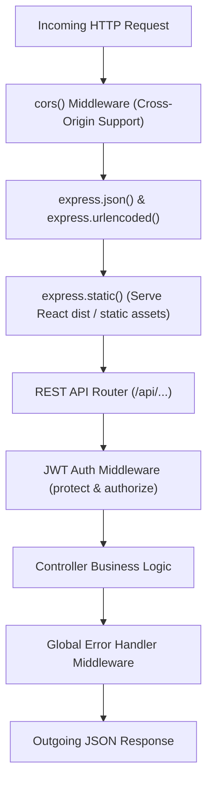

# HotelPro - Backend Structure Specification

This document provides a comprehensive breakdown of the backend directory structure, architectural organization, and routing hierarchy in **HotelPro** to satisfy **SkillWallet Epic 3: Backend Development (Task 10)**.

---

## 1. Backend Structural Layout (`server/`)

```
server/
├── config/
│   └── db.js                 # MongoDB connection logic with Mongoose & fallback
├── controllers/
│   ├── authController.js     # User registration, login, profile & JWT issuance
│   ├── roomController.js     # Room filtering, search, sorting & inventory updates
│   ├── bookingController.js  # Reservation creation, cancellation & tax invoicing
│   ├── hotelController.js    # Hotel brand profile, policies & admin metrics
│   └── reviewController.js   # Verified guest reviews & ratings
├── middleware/
│   └── auth.js               # JWT bearer verification & role authorization (RBAC)
├── models/
│   ├── User.js               # User schema with bcrypt password hashing
│   ├── Room.js               # Room/Suite schema with category & pricing rules
│   ├── Hotel.js              # Hotel entity schema with facilities & policies
│   ├── Booking.js            # Booking schema with GST 18% calculation
│   └── Review.js             # Verified guest testimonial schema
├── routes/
│   ├── authRoutes.js         # /api/auth route definitions
│   ├── roomRoutes.js         # /api/rooms route definitions
│   ├── bookingRoutes.js      # /api/bookings route definitions
│   ├── hotelRoutes.js        # /api/hotel route definitions
│   └── reviewRoutes.js       # /api/reviews route definitions
├── seed/
│   └── seed.js               # Database population script with rich initial data
├── .env                      # Environment variable definitions
├── package.json              # Backend package manifest and scripts
└── server.js                 # Express server bootstrap & route mounting
```

---

## 2. Express Middleware Pipeline
Incoming requests traverse a disciplined sequence of Express middlewares in `server.js`:



---

## 3. API Route Mapping

| Route Prefix | File | Key Endpoints | Purpose |
|---|---|---|---|
| `/api/auth` | `authRoutes.js` | `POST /register`, `POST /login`, `GET /me` | User management & JWT authentication |
| `/api/rooms` | `roomRoutes.js` | `GET /`, `GET /:id`, `POST /`, `PUT /:id` | Room catalog, search, filter, and inventory |
| `/api/bookings` | `bookingRoutes.js` | `POST /`, `GET /my`, `POST /:id/cancel`, `GET /` | Reservations, 1-click refund cancellation |
| `/api/hotel` | `hotelRoutes.js` | `GET /`, `GET /stats` | Hotel information & admin occupancy stats |
| `/api/reviews` | `reviewRoutes.js` | `GET /`, `POST /` | Verified guest testimonials & star ratings |
| `/api/health` | `server.js` | `GET /health` | System uptime & database connection check |
