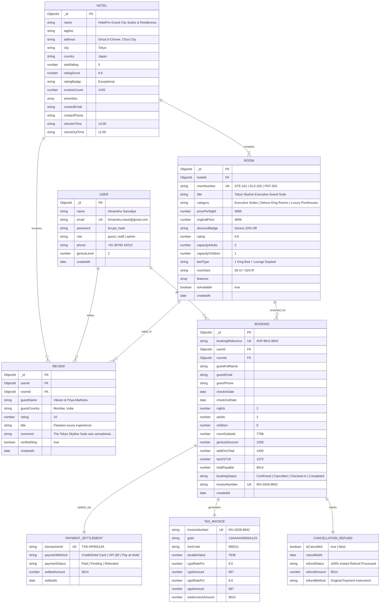

# HotelPro - Entity Relationship (ER) Diagram

This document illustrates the data architecture, entity relationships, and Mongoose ODM schema mappings for **HotelPro - Complete Hotel Booking & Management Solution**.

---

## 1. Complete Relational Entity Relationship Diagram

---

## 2. Relational Schema & Cardinality Specifications

| Relationship | Cardinality | Business Logic & Constraint |
|---|---|---|
| **Hotel ➔ Room** | 1 to Many (1:N) | A hotel property manages multiple luxury room inventories categorized by suite tiers. |
| **User ➔ Booking** | 1 to Many (1:N) | A registered guest or visitor can place multiple bookings over time. |
| **Room ➔ Booking** | 1 to Many (1:N) | A room can have sequential reservations across distinct stay calendar windows. |
| **Booking ➔ Payment** | 1 to 1 (1:1) | Each confirmed reservation links directly to a unique transaction payment record. |
| **Booking ➔ Tax Invoice** | 1 to 1 (1:1) | Each confirmed reservation automatically generates an itemized GST Tax Invoice. |
| **Booking ➔ Cancellation** | 1 to 1 (1:1) | 1-Click free cancellation updates the booking lifecycle and issues a 100% refund. |
| **User ➔ Review** | 1 to Many (1:N) | Verified guests submit reviews and star ratings linked to their stay. |

---

## 3. Data Integrity & Normalization Standards
1. **Third Normal Form (3NF):** Elimination of transitive dependencies between rooms, taxes, and customer entities.
2. **Denormalization for Fast Read Scaling:** Key room snapshot details (`title`, `roomNumber`, `pricePerNight`) are captured within the `Booking` record to guarantee historical accuracy even if room rates change later.
3. **Atomic State Updates:** Booking status transitions (`Confirmed` ➔ `Cancelled`) execute atomically with instant refund status updates.
