# HotelPro - Frontend Structure Specification

This document details the frontend component architecture, directory organization, and styling system implemented in `client/` for **HotelPro** to satisfy **SkillWallet Epic 5: Frontend Development (Task 15)**.

---

## 1. Frontend Component Hierarchy Diagram

```mermaid
graph TD
    App["App.jsx (Root Layout & Router)"]
    App --> Navbar["Navbar.jsx (Brand Logo, Nav Links & 1-Click Role Switcher)"]
    App --> RouteContainer["Routes (React Router DOM)"]
    App --> Footer["Footer.jsx (Heritage, Amenities & GSTIN)"]

    RouteContainer --> HomePage["HomePage.jsx"]
    RouteContainer --> RoomsPage["RoomsPage.jsx"]
    RouteContainer --> CheckoutPage["CheckoutPage.jsx"]
    RouteContainer --> MyBookingsPage["MyBookingsPage.jsx"]
    RouteContainer --> LoginPage["LoginPage.jsx"]
    RouteContainer --> AdminDashboardPage["AdminDashboardPage.jsx"]

    HomePage --> SearchBar["SearchBar.jsx (Destination, Dates, Guests)"]
    HomePage --> FilterEngine["Category Pills & Price Filter Buttons"]
    HomePage --> RoomGrid["RoomCard.jsx (Image, Pricing, Genius 20% Badge, Rating)"]
    HomePage --> AmenitiesSection["Amenities Grid (Pool, Spa, Bistro, Workstation)"]
    HomePage --> ReviewsSection["Verified Guest Reviews & FAQ Accordion"]

    CheckoutPage --> GalleryMosaic["5-Photo Interactive Gallery Mosaic"]
    CheckoutPage --> NightsSelector["Stay Nights Selector (1, 2, 3, 7 nights)"]
    CheckoutPage --> AddOnsToggles["Add-On Options (Breakfast, Chauffeur, Late Checkout)"]
    CheckoutPage --> GuestForm["Guest Information & Payment Method Form"]
    CheckoutPage --> VoucherModal["BookingVoucherModal.jsx (Confirmed Stay Voucher)"]

    MyBookingsPage --> BookingCards["Confirmed Stay Cards"]
    MyBookingsPage --> CancelButton["1-Click Free Cancel Button (100% Refund)"]
    MyBookingsPage --> VoucherModal
    MyBookingsPage --> InvoiceModal["TaxInvoiceModal.jsx (GST 18% HSN 996311)"]

    AdminDashboardPage --> MetricsCards["Telemetry Metrics (Occupancy %, Revenue, Bookings)"]
    AdminDashboardPage --> InventoryTable["Suite Inventory Availability Control Table"]
```



---

## 2. Directory Layout & Key Modules

```
client/src/
├── components/
│   ├── Navbar.jsx               # Top navigation with role switcher (Guest, Staff, Admin)
│   ├── Footer.jsx               # Footer with location, policies, and GST tax accreditation
│   ├── SearchBar.jsx            # Real-time destination, date range, and guests customizer
│   ├── RoomCard.jsx             # Luxury suite card with Genius discount and booking trigger
│   ├── BookingVoucherModal.jsx  # Digital booking reference card with printable layout
│   └── TaxInvoiceModal.jsx      # Official GST tax invoice modal with CGST/SGST itemization
├── context/
│   └── AuthContext.jsx          # User state, JWT token storage & 1-click persona switching
├── pages/
│   ├── HomePage.jsx             # Comprehensive landing page with search, filters, and FAQs
│   ├── RoomsPage.jsx            # Dedicated full-catalog suite view with live text search
│   ├── CheckoutPage.jsx         # Reservation page with photo gallery, nights & add-ons
│   ├── MyBookingsPage.jsx       # Stay management, cancellation & invoice desk
│   ├── LoginPage.jsx            # Sign-in and register portal with 1-click evaluation presets
│   └── AdminDashboardPage.jsx   # Staff & Admin suite inventory management desk
├── services/
│   └── api.js                   # Asynchronous HTTP client with fallback mock resilience
├── App.jsx                      # Route definitions and master page scaffolding
├── index.css                    # Booking.com navy design tokens & custom styling
└── main.jsx                     # Root React DOM bootstrap
```

---

## 3. Design System & CSS Tokens (`client/src/index.css`)
HotelPro utilizes a curated color palette inspired by Booking.com:
* **Deep Navy (`--primary-navy`):** `#003580` (Primary headers, buttons, rating badges)
* **Action Blue (`--primary-blue`):** `#006ce4` (Buttons, active tabs, interactive links)
* **Warm Accent Gold (`--accent-yellow`):** `#febb02` (Search bar border, Genius badges, highlights)
* **Emerald Green (`--tag-green`):** `#008009` (Free cancellation guarantee, breakfast tags)
* **Crisp Gray (`--bg-page`):** `#f5f7fa` (Modern, readable background)
* **Typography:** Modern geometric sans-serif (`Plus Jakarta Sans`).
