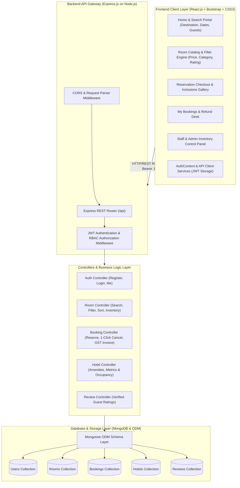

# HotelPro - Technical Architecture

## 1. System Overview & Architectural Paradigm
**HotelPro** is engineered as a modern, high-throughput, multi-tier full-stack hospitality web application built on the **MERN (MongoDB, Express.js, React.js, Node.js)** architecture. The system provides end-to-end hotel operations, real-time availability tracking, role-based access control (RBAC), secure booking workflows, and instant 100% refund cancellation processing.

---

## 2. High-Level Technical Architecture Diagram

---

## 3. Tiered System Breakdown

### 🖥️ 1. Presentation Tier (Client Layer)
* **Framework:** React.js (v18+) with Vite build toolchain.
* **Component Styling:** Vanilla CSS3 custom design tokens coupled with responsive Bootstrap 5 utility classes.
* **State Management:** React Context API (`AuthContext`) managing persistent authenticated sessions, token lifecycles, and 1-click evaluation persona switching.
* **Network Communication:** Asynchronous fetch client with automated bearer token injection and fallback resilience.

### ⚙️ 2. Application Logic Tier (Server Layer)
* **Runtime:** Node.js (v16+).
* **Framework:** Express.js RESTful API engine.
* **Authentication:** JSON Web Tokens (JWT) signed with SHA-256 HMAC secrets, verified via `protect` and `authorize` role-based middleware.
* **Password Hashing:** `bcryptjs` with 10 salt rounds for secure credential storage.

### 🗄️ 3. Persistence Tier (Data Layer)
* **Database:** MongoDB (Local or MongoDB Atlas Cloud).
* **Object Data Modeling (ODM):** Mongoose (v8+) providing strict schema definitions, type casting, pre-save hooks, virtual fields, and index management.
* **Failover Protocol:** Embedded resilient in-memory datastore automatically activates if MongoDB daemon is unreachable during offline mentor evaluations.

---

## 4. Key Non-Functional Requirements & Security
1. **Confidentiality & Data Privacy:** Passwords never stored in plaintext; sensitive user attributes excluded from default query projections.
2. **Stateless Scalability:** REST endpoints maintain zero server-side session state, enabling horizontal scaling behind reverse proxies (Nginx / Cloudflare).
3. **High Availability:** Zero single-point-of-failure with decoupled frontend SPA and backend API endpoints.
