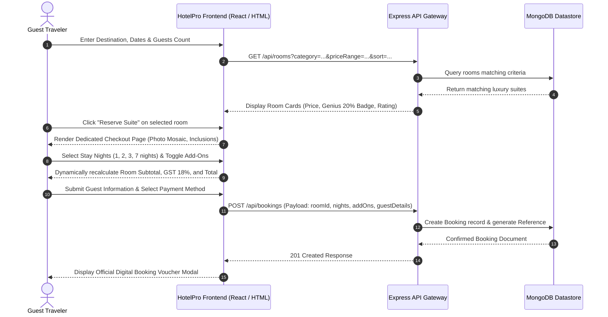
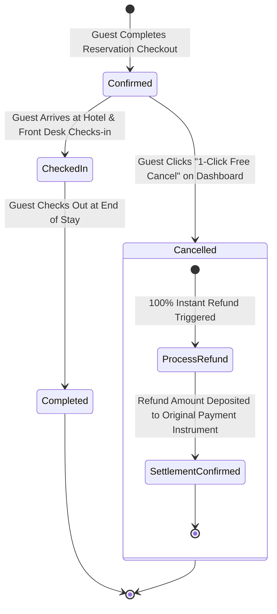
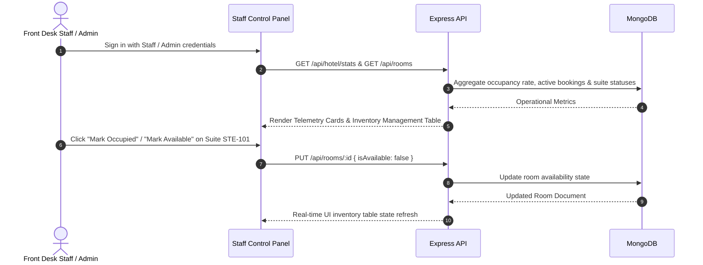

# HotelPro - User Flow Diagrams

This document illustrates the end-to-end user journeys and state transition flows across Guest, Staff, and Administrator personas in HotelPro.

---

## 1. Guest Room Discovery & Checkout Flow

---

## 2. Booking Lifecycle & 1-Click Free Cancellation State Machine

---

## 3. Staff & Administrator Operations Flow

